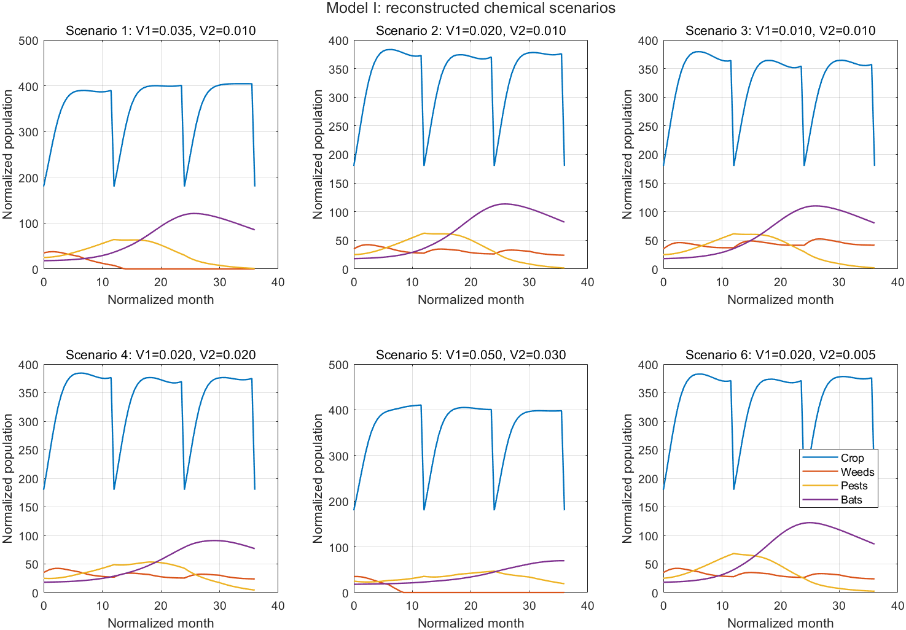
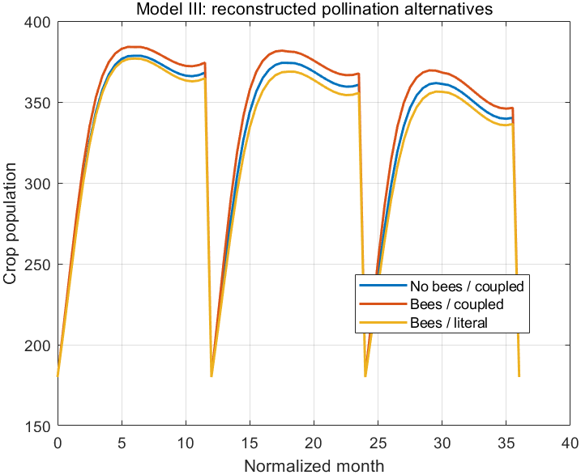
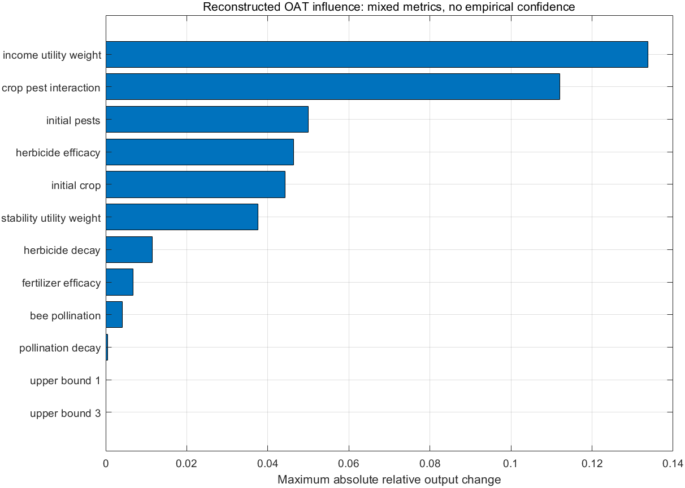

[English](README.md) | [简体中文](README.zh-CN.md) | [日本語](README.ja.md) | [繁體中文](README.zh-TW.md)

# 2025 ICM Problem E 農地生態系モデルの再構築

2025 ICM Problem E を題材とした 4 つのモデリング手順を MATLAB で再構築したプロジェクトです。再現手順の検討、成果紹介、教育を目的とします。現在のリリース：[v1.0.0](https://github.com/HanamiGekka/ICM2025-Problem-E-Reconstruction/releases/tag/v1.0.0)。

**元の競技コード全体は復元されていません。Models I–III の一部のパラメーターは明示した再構築上の仮定であり、当時の正確な値ではありません。実証検証済みの農業予測システムでもありません。** 論文、残存する数式のメモ、過去の実装の一部の挙動、記録済みの結果を根拠にしています。Task4 は過去の挙動に合わせた版と修正版を分けて保持します。

## モデルの概要

| モデル | 実行できる手順 | 根拠と仮定 |
| --- | --- | --- |
| I：4 種 | 薬剤量 6 条件、イベント付き ODE、収穫・植え直し、推移とヒートマップ | 論文の方程式と用量ラベル。係数、初期値、日程、ソルバーは新たな仮定 |
| II：6 種 | F/V1/V2 最適化、独立した格子探索、前後比較、収束 | 論文の方程式と単位費用。N4² と N4*N6 を併記し、選好は新規設定 |
| III：7 種 | V1=0、ハチ導入、記述どおりの受粉と個体数に結合した受粉、F/V2 最適化 | 根拠のある除草剤除去。代替結合と新しい係数を明示 |
| IV／Task4：8 種 | 16 の有機戦略、意図した／過去の Pareto、決定的な CA/RGB | 残存コードの証拠。互換版と修正版を分離 |

設定 → 明示した微分方程式の右辺 → 区間積分とイベント → 多様性・安定性・作物指標の集計 → 制約付き探索／格子探索 → 書き出し・比較・感度分析、という流れです。Models I–III は共通の計算カーネルを使います。

[70 行のパラメーター表](config/reconstruction_parameters.csv)と[仮定の説明](docs/methodology/ASSUMED_PARAMETERS.md)に、正規化単位、範囲、出所、`documented_only`、`reconstructed_baseline`、`reconstructed_low`、`reconstructed_high` の 4 設定を記載しています。`documented_only` は未知の値を NaN のまま保持します。過去の目標値に合わせる事後的な校正や調整は行いません。

## 出力例







既存の MATLAB 再構築出力です。新たな農地観測や、今回の文書更新で再計算した結果ではありません。

## 資料と用語の区別

| 区分 | このリポジトリでの意味 |
| --- | --- |
| 元の歴史資料 | 公開の許可を得た論文と証明書。他の過去の資料は非公開 |
| 再構築実装 | 証拠と明示した選択に基づく実行可能な MATLAB コード。元の競技コード全体ではない |
| 新たな仮定 | 表と方法文書に示した係数、初期値、日程、ソルバー、選好 |
| 過去との互換版 | `historical_compat` は残存資料で裏付けられた Task4 の挙動を保持 |
| 修正版 | `corrected` は時間範囲、害虫数ゼロの規則、選好の修正を開示し、一部の出力を意図的に変更 |
| 再現出力 | 再構築手順で生成した図、CSV、検証ファイル。農業の実測値ではない |

## MATLAB クイックスタート

検証済み環境は **MATLAB R2023b（23.2.0.2365128）、Windows x64、基本 MATLAB のみ**です。数値計算に追加ツールボックスや Python 環境は不要です。リポジトリのルートから実行します。

```matlab
addpath('src/matlab','tests/matlab');
run_checks('public');
export_task4('historical_compat');
export_task4('corrected');
export_ca_scenarios;
export_historical_comparison;
export_full_reconstruction;
verify_exports;
```

Windows PowerShell ラッパーも利用できます。MATLAB を PATH から使うか、`-MatlabExe` に既存の実行ファイルを指定します。

```powershell
.\scripts\run_reconstruction.ps1 -Public -MatlabExe matlab
```

単独のシミュレーション例：

```matlab
c = reconstruction_config(3,'reconstructed_baseline');
r = simulate_reconstructed(c);
o = optimize_reconstructed(c);
rOptimized = simulate_reconstructed(c,o.decision);
```

## 主な結果と制約

基準設定の選好では、Models II と III の目的関数は薬剤量ゼロを選びます。効用が上がる一方で作物指標は下がり、F=0 では表示する安定性の代理指標がゼロになります。**仮定した目的関数による計算結果であり、農業上の助言ではありません。** 格子探索との一致も、連続空間での大域最適性の証明にはなりません。[結果報告](docs/results/RECONSTRUCTION_RESULTS.md)は決定値、不一致、構造の代替形式を記載し、[感度分析](docs/results/SENSITIVITY_REPORT.md)は ±10%／±20%、再正規化した重み、範囲、高低のストレス設定を扱います。

Task4 の互換版は、表示精度で Table5 の全 14 行に一致します。意図した選好と、残存コードの逆向きの Pareto フィルターは異なります。修正版の耕地指標は時間範囲と害虫ゼロ規則のため意図的に異なり、一致させる調整はしません。Models I–III は新たな設定を使うため、過去の目標値とは一致しません。Model II の矛盾する目標群は分けて保存します。図の正規化も再構築時の表示上の約束です。

構造に関する証拠は、経験的な妥当性を保証しません。初期モデルの正確なパラメーター、元のソルバー・イベント、GA 履歴、乱数状態、回帰サンプルと R² は復元できていません。ハチと作物の結合は議論のあるモデルで、生物学的な検証はありません。繰り返し施用でも費用は正規化した単回用量の指標です。[範囲](docs/methodology/RECONSTRUCTION_SCOPE.md)、[修正](docs/methodology/CORRECTIONS.md)、[出所](docs/methodology/PARAMETER_PROVENANCE.md)を参照してください。

## 再現性と構成

公開用の検査に非公開の Original アーカイブは不要です。非公開用の検査はさらに 74 の歴史ファイルと目標値の転記を確認します。数値配列と CSV は決定的ですが、UTC 生成情報や PNG の時刻は変わることがあります。CA は明示した固定 twister シードを使い、呼び出し元の RNG 状態を戻します。[再現性の説明](docs/methodology/REPRODUCIBILITY.md)に詳細があります。今回の作業では MATLAB の書き出しを再実行していません。

| ディレクトリ | 用途 |
| --- | --- |
| `config/` | パラメーターと目標値の出所表 |
| `src/matlab/`、`tests/matlab/` | 方程式、シミュレーション、最適化、CA、書き出し、公開用検査 |
| `docs/methodology/`、`docs/results/` | 仮定、出所、修正、再現手順、結果 |
| `results/reproduced/` | 生成済みの再構築図、CSV、設定、検証 JSON |
| `historical-documents/` | 個別に公開許可を得た論文と証明書。MIT ソフトウェアライセンスの対象外 |

## 歴史資料、引用、ライセンス

[元の論文と受賞証明書](historical-documents/README.md)は個別の許可に基づく歴史資料のコピーです。名前、署名、メタデータを含めて元のバイト列を保持し、他の非公開資料は含めません。結果を再利用する場合はリリース **v1.0.0**、パラメーター設定、Task4 の版を明示し、元の競技コード全体として引用しないでください。

[MIT ライセンス](LICENSE)は、適切な権利を持つ新規作成の再構築ソフトウェアだけに適用します。歴史論文、証明書、非公開の過去のコード、参考論文、データセット、写真、第三者資料の権利は付与しません。出所を示した目標値の転記も、ソフトウェアの許諾範囲を広げるものではありません。公開履歴は独立しており、明示した許可リストで審査しています。歴史 PDF の例外は、ハッシュを固定した 2 ファイルだけです。
